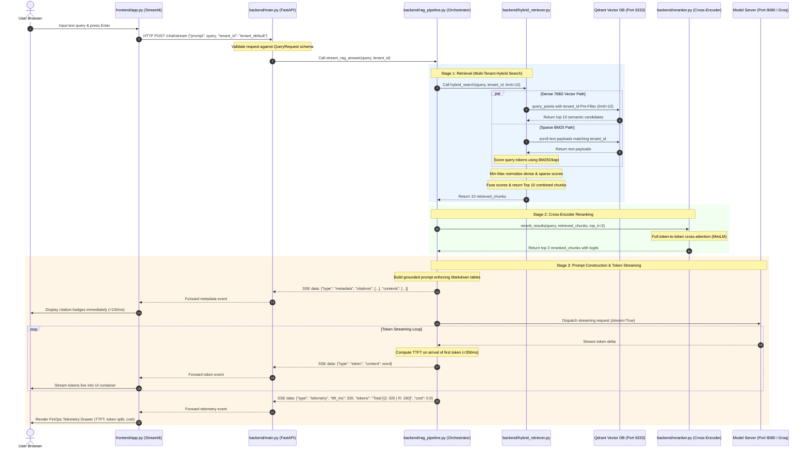

# Project Flow & Execution Architecture: `16) project_flow.md`

This document details the complete end-to-end flow of data across ingestion, hybrid search, cross-encoder reranking, SSE token streaming, and telemetry tracking in this Multi-Tenant Hybrid RAG platform.

---

## 1. End-to-End System Flowchart

```mermaid
flowchart TD
    subgraph Ingestion [Offline Data Ingestion: injest_documents.py]
        DocIn[PDF / TXT Documents in data/] --> BBoxCrop[Geometric Bounding-Box Table Cropping]
        BBoxCrop --> Chunking[Chunker with Pre-Table Split Isolation]
        Chunking --> MetaTag[Dynamic Chunk-Level has_table & tenant_id Tagging]
        MetaTag --> BGE768[768D Vector Embedding: BAAI/bge-base-en-v1.5]
        BGE768 --> QdrantStore[(Qdrant Vector Database: rag_docs)]
    end

    subgraph Frontend [Streamlit UI: app.py]
        UserQuery[User Prompt String: query] --> UIEvent[HTTP POST to /chat/stream with tenant_id]
        UIEvent --> TokenListen[SSE EventSource Listener]
        TokenListen --> LiveRender[Live Streaming Markdown Renderer]
        TokenListen --> Drawer[Telemetry Drawer: TTFT, Token Split, Cost]
    end

    subgraph API [FastAPI Web Gateway: main.py]
        UIEvent --> Validate[Pydantic QueryRequest Validation]
        Validate --> StreamRoute[/chat/stream SSE Streaming Endpoint]
    end

    subgraph Orchestration [RAG Pipeline: rag_pipeline.py]
        StreamRoute --> GenStream[stream_rag_answer]
        
        subgraph Retrieval [Two-Stage Hybrid Search: hybrid_retriever.py]
            GenStream --> HybridCoord[Hybrid Search Coordinator]
            
            HybridCoord --> DenseSearch[semantic_retriever.py]
            DenseSearch --> QdrantQuery[768D Cosine Search with tenant_id Pre-Filter]
            QdrantQuery --> QdrantStore
            
            HybridCoord --> LexicalSearch[bm25_retriever.py]
            LexicalSearch --> BM25Index[BM25Okapi Lexical Match]
            
            QdrantQuery --> NormFusion[Min-Max Normalization & Fusion]
            BM25Index --> NormFusion
            NormFusion --> Candidates[Top 10 Candidate Chunks]
        end
        
        subgraph Reranking [Cross-Encoder Filter: reranker.py]
            Candidates --> CrossEnc[Cross-Encoder: ms-marco-MiniLM-L-6-v2]
            CrossEnc --> Top3[Top 3 Precision Chunks]
        end
        
        Top3 --> PromptBuild[Prompt Synthesis with Markdown Table Directives]
        
        subgraph ModelServer [Multi-Provider LLM Engine]
            PromptBuild --> ProviderSwitch{LLM_PROVIDER}
            ProviderSwitch -->|local| LlamaCpp[llama-server.exe: Qwen 2.5 7B GGUF on 8080]
            ProviderSwitch -->|groq| GroqCloud[Groq API: Llama-3.3-70B-Versatile]
        end
        
        LlamaCpp --> SSEStream[SSE Event Stream Generator]
        GroqCloud --> SSEStream
        
        SSEStream --> MetadataEvt[data: type: metadata citations]
        SSEStream --> TokenEvts[data: type: token content]
        SSEStream --> TelemetryEvt[data: type: telemetry TTFT, Tokens, Cost]
    end

    MetadataEvt --> TokenListen
    TokenEvts --> LiveRender
    TelemetryEvt --> Drawer
```

---

## 2. Request-Response Sequence Diagram (SSE Streaming)



---

## 3. Step-by-Step Execution Variable Trace Walkthrough

#### Step 1: User Input
The user enters the question `"What are the common dataset split strategies in machine learning?"`.
* **Variable**: `query` (Type: `str`)
* **Context**: Managed by **[app.py](file:///d:/projects/hybrid_rag%20-%20Copy/frontend/app.py)**.

#### Step 2: Request Serialization
The frontend packages user inputs and tenant context into a JSON payload:
* **Variable**: `payload` = `{"prompt": query, "tenant_id": "tenant_default", "user_id": "usr_admin"}`
* **Context**: Sent via `httpx.AsyncClient().stream("POST", "/chat/stream")` in **[app.py](file:///d:/projects/hybrid_rag%20-%20Copy/frontend/app.py)**.

#### Step 3: Schema Validation
FastAPI parses and validates the incoming body against the strict Pydantic model:
* **Variable**: `request` (Type: `QueryRequest`)
* **Context**: Enforced in **[main.py](file:///d:/projects/hybrid_rag%20-%20Copy/backend/main.py)**.

#### Step 4: Hybrid Search Bootstrapping
The orchestrator triggers `hybrid_search()` with multi-tenant filtering:
* **Function**: `hybrid_search(query, tenant_id="tenant_default", limit=10)`
* **Context**: Executed in **[hybrid_retriever.py](file:///d:/projects/hybrid_rag%20-%20Copy/backend/hybrid_retriever.py)**.

#### Step 5: Dense 768D Vector Search
The query string is converted to a 768-dimensional normalized embedding:
* **Variable**: `query_vector` (Type: `list[float]`, length = 768)
* **Context**: Generated using `BAAI/bge-base-en-v1.5` in **[embedding_model.py](file:///d:/projects/hybrid_rag%20-%20Copy/backend/embedding_model.py)**. Qdrant performs cosine search with `FieldCondition(key="tenant_id", match=MatchValue(value="tenant_default"))`.

#### Step 6: Sparse Lexical (BM25) Scoring
In parallel, BM25 scores query tokens against documents matching `tenant_id`:
* **Variable**: `bm25_results` (Type: `list[dict]`)
* **Context**: Executed in **[bm25_retriever.py](file:///d:/projects/hybrid_rag%20-%20Copy/backend/bm25_retriever.py)**.

#### Step 7: Score Normalization & Fusion
Scores are normalized to $[0.0, 1.0]$ and summed by chunk ID:
* **Variable**: `retrieved_chunks` (Type: `list[dict]`, length = 10)
* **Context**: Handled by `normalize_scores()` in **[hybrid_retriever.py](file:///d:/projects/hybrid_rag%20-%20Copy/backend/hybrid_retriever.py)**.

#### Step 8: Cross-Encoder Reranking
The 10 hybrid candidates are paired with the query and passed to the Cross-Encoder:
* **Model**: `cross-encoder/ms-marco-MiniLM-L-6-v2`
* **Variable**: `reranked_chunks` (Type: `list[dict]`, length = 3)
* **Context**: Managed by `rerank_results()` in **[reranker.py](file:///d:/projects/hybrid_rag%20-%20Copy/backend/reranker.py)**. Top 3 highest-logit passages are selected.

#### Step 9: Structured Grounded Prompt Synthesis
The orchestrator combines context chunks, extracts citations, and builds the prompt:
* **Variable**: `prompt` (Type: `str`) enforcing factual grounding and Markdown table formatting.
* **Context**: Built by `build_rag_prompt()` in **[rag_pipeline.py](file:///d:/projects/hybrid_rag%20-%20Copy/backend/rag_pipeline.py)**.

#### Step 10: SSE Streaming Generation
The OpenAI-compatible client dispatches the request to the configured model (`Qwen2.5-7B` on port 8080 or Groq):
* **Event 1 (`metadata`)**: Yields source filenames, contexts, and chunk IDs.
* **Event 2 (`token`)**: Yields individual text tokens as they generate. TTFT is recorded at the first token.
* **Event 3 (`telemetry`)**: Yields final JSON containing `ttft_ms`, `prompt_tokens`, `completion_tokens`, and `estimated_cost_usd`.
* **Context**: Streamed from `stream_rag_answer()` in **[rag_pipeline.py](file:///d:/projects/hybrid_rag%20-%20Copy/backend/rag_pipeline.py)**.

#### Step 11: UI Rendering & FinOps Telemetry Drawer
The frontend consumes the SSE stream:
* Answer markdown streams directly into the active chat message container.
* Sources are displayed as interactive badges.
* Telemetry drawer expands to display:
  `Tokens: Total [Q: prompt | R: completion]`, `TTFT: ... ms`, and `Cost: $...`.
* **Context**: Rendered by **[app.py](file:///d:/projects/hybrid_rag%20-%20Copy/frontend/app.py)**.
